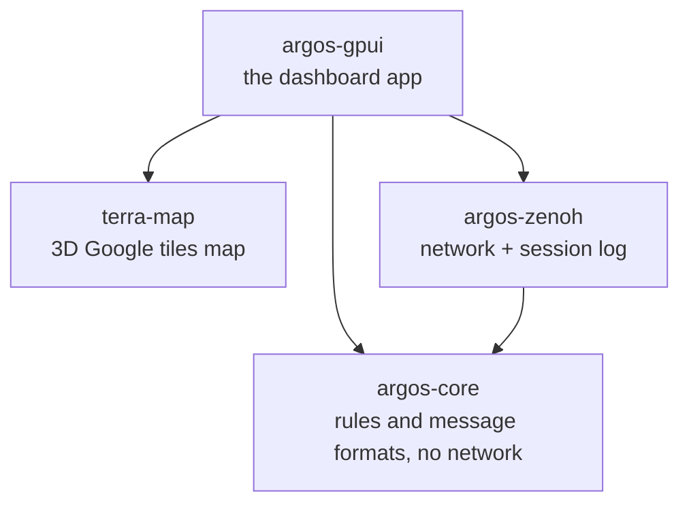
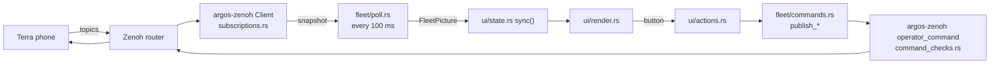

# Code map

Where things live, how data moves, and which file to open for a change. For setup and settings, see [README.md](README.md).

## Crates



| Crate | Job | Rule of thumb |
| --- | --- | --- |
| `argos-core` | Message formats, level rules, drive shaping, goal checks | "Is this allowed? What does this JSON mean?" |
| `argos-zenoh` | Router connection, subscriptions, publishing, session log | "Bytes on the wire" |
| `argos-gpui` | The window, the fleet feed thread, FPV video, agent/MCP | "What the operator sees and clicks" |
| `terra-map` | wgpu 3D tiles, camera, rover models | "The 3D map itself" |

`crates/argos-ffi` (UniFFI bindings for the removed Swift apps) and `spikes/unity-dashboard` are not used by the dashboard.

## Data flow



The window never talks to Zenoh directly. It reads a shared `FleetPicture` every 100 ms and calls `FleetFeed` methods to send.

## argos-gpui layout

`src/main.rs` + `src/ui/` is the window. Every other file in `src/` is the library. The full file table is in [crates/argos-gpui/README.md](crates/argos-gpui/README.md).

## Where to edit

| I want to change… | Open | Look for |
| --- | --- | --- |
| A button or section in the rover panel | `argos-gpui/src/ui/` | `inspector.rs` (`overview_tab`), `levels.rs`, `task.rs`, `sections.rs`, `drive.rs` |
| The top console bar | `ui/console_bar.rs` | `console_bar` |
| Rover cards on the map | `ui/cards.rs` | `rover_card` |
| What a button does when clicked | `ui/actions.rs` | `stop_rover`, `start_explore`, `start_task`, `begin_drive`, `set_study` |
| What a callout, trace line, or stop reason says | `argos-gpui/src/console.rs` | tests in `tests/argos-gpui/unit/console_tests.rs` |
| Send a new command to the rover | `fleet/commands.rs` → `argos-zenoh/src/lib.rs` → `command_checks.rs` | copy a `publish_*`; allow the topic in `operator_command` |
| Show a new telemetry value | `argos-zenoh/src/subscriptions.rs` → `fleet/marks.rs` | add a field to `RoverMark`, fill it in `fleet_marks` |
| Level names, allowed levels, study lock | `argos-core/src/autonomy.rs` | `OPERATOR_LEVELS`, `STUDY_LEVELS`, `level_label` |
| Teleop speed and turn shaping | `argos-core/src/drive.rs` | `TeleopLimits`; held-key sending in `argos-zenoh/src/teleop_worker.rs` |
| A `.env` setting | `fleet/config.rs` | `SETTING_KEYS`, `DashboardConfig::parse` |
| Grid, route, goal drawing on the map | `ui/map_overlay.rs`, `ui/local_map.rs` | `map_paint` |
| Click-to-goal | `ui/interaction.rs`, `ui/popups.rs` | `click_map`, `goal_popup` |
| Colors | `ui/palette.rs` | |
| FPV video | `argos-gpui/src/fpv/` and `ui/video.rs` | `session.rs`, `present.rs` |
| Agent / MCP / recommendation cards | `ui/agent.rs`, `agent_mcp.rs`, `argos-core/src/agent.rs` | |
| Session log and Export log | `argos-zenoh/src/session_log.rs` | |
| The 3D map, camera, tiles | `terra-map/src/maps/` | `camera.rs`, `renderer.rs` |

## Before you push

```sh
cargo fmt --all
cargo test --workspace --exclude argos-unity-bridge
cargo clippy -p argos-gpui -p argos-zenoh --all-targets
```
