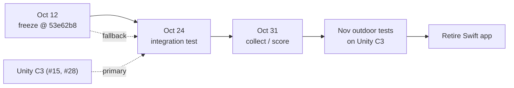

# Swift app freeze — Oct 24/31 fallback

> **Summary.** `apps/apple` is **frozen** from **Oct 12, 2026**. It is the fallback
> operator station for the **Oct 24 integration test** and the **Oct 31 collect/score
> run** while the Unity C3 station (#15) is built. No new Swift features. Tracks #25.

| | |
| --- | --- |
| Frozen at | `main` @ `53e62b8` ("visualize global routes and local planner candidates") |
| Tag | `swift-fallback-2026-10-12` (to be created on `53e62b8` by Yojan) |
| Has | level picker, takeover, held teleop, stop, proposals, routes / planner candidates |
| Allowed changes | shared Rust fixes only (#27, #29) via `argos-core` / `argos-zenoh` / `argos-ffi` |
| Retire | after the Unity C3 runs the November outdoor tests |



## Build the fallback (Apple Silicon Mac, Xcode)

```sh
git fetch --tags && git checkout swift-fallback-2026-10-12   # or 53e62b8
./scripts/build-apple.sh                                       # Rust FFI -> ArgosCore.xcframework
xcodebuild -project apps/apple/ARGOS.xcodeproj -scheme ARGOSMac \
  -destination 'platform=macOS,arch=arm64' -derivedDataPath apps/apple/build \
  build CODE_SIGNING_ALLOWED=NO
open apps/apple/build/Build/Products/Debug/ARGOS*.app
```

Quick check: `cargo test --workspace --locked`, then the `ARGOSMacTests` command in
the root `README.md` ("Native checks"). If a shared Rust fix lands, rebuild from
`main` and re-run the same steps.

## Rules

- No feature PRs touching `apps/apple/**` until retirement. Bug fixes needed for
  Oct 24/31 only, and say so in the PR.
- Last Mac build check: **_not yet run_** — Yojan, fill in date + result here.
