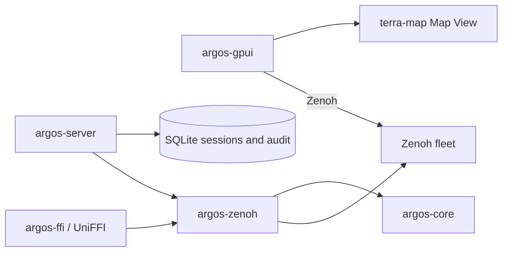

# ARGOS architecture and control boundary

ARGOS is a fleet operator station. The GPUI dashboard (`crates/argos-gpui`) mounts the Map View from `crates/terra-map`. The Rust Axum service validates authenticated requests and owns one fleet worker. The window does not call that service yet. Terra owns sensing, onboard planning, final motor selection, and watchdogs.

| Component | Responsibility |
| --- | --- |
| `crates/argos-gpui` | Dashboard window. Mounts `MapView` and publishes goals, autonomy, and teleop for one selected rover |
| `crates/terra-map` | Google 3D Tiles and georeferenced models (`terra_map`) |
| `crates/argos-server` | OAuth/session roles, CSRF/origin checks, claims, command engine, SSE, persistence |
| `crates/argos-core` | Contracts, projection, freshness, acknowledgement and operator state |
| `crates/argos-zenoh` | Fleet transport, validated telemetry, command publication, session logs |
| `crates/argos-ffi` | UniFFI facade. The Swift dashboard that linked it has been removed |
| `spikes/unity-dashboard` | Historical Unity prototype; not the selected product UI |
| `packaging/web`, `packaging/gcp` | Hosted service/router packaging. No browser bundle |

## Observation and command semantics

The service broadcasts fleet snapshots at 5 Hz. Large occupancy arrays are fetched separately for the selected rover. IDs and sequence values crossing the browser boundary use strings to preserve 64-bit precision. Unknown pose and incompatible frames remain visibly unknown; geographic conversion requires reported alignment.

Fleet supervision and waypoint submission use a 90-second freshness horizon; goal acknowledgement waits up to 150 seconds. Manual/hardware controls enforce stricter freshness. Occupancy display has its own 2.5-second stale threshold. These are receipt ages, not a claim of synchronized end-to-end sensor time.

Waypoint requests are reviewed against run/frame identity and checked again before publication. A matching vehicle token confirms acceptance; publication alone does not. Cancel waits for a newly observed idle report. No reconnect or restart replays commands, and a published vehicle goal can outlive the browser session.

Hardware arm is explicit, short-lived, and bound to the observed run/authority revision. Disarm remains available with stale observations. Geometry/avoidance configuration requires disarmed ready hardware and is acknowledged separately from a request being sent. Mode selection never arms the vehicle.

Held browser driving uses fresh manual authority, ordered pulses, queue expiry, and a server-side deadman. Emergency stop attempts the vehicle safety latch, cancellation, and disarm; publication is not physical-stop acknowledgement. Safety reset remains in the legacy native interface.

## Authentication and ownership

GitHub OAuth identifies invited numeric account IDs as viewer or operator. Hosted cookies are secure and HTTP-only; mutations require same-origin and CSRF validation. A browser tab renews a 30-second command claim every ten seconds. SQLite persists sessions and command/audit records; claims remain in memory, so production uses one instance.

The browser claim does not fence native clients on Zenoh. Avoid simultaneous native/browser operators. The vehicle remains the final authority on whether a request can execute.

## Migration status

The GPUI map is the primary development target. The service still implements the command gates described below; the window does not expose them yet. The [removed browser dashboard](browser-dashboard.md) records the React controls, and the [roadmap](roadmap.md) lists what is still unwired. Historical plans describe their original slice and are not the current architecture.
