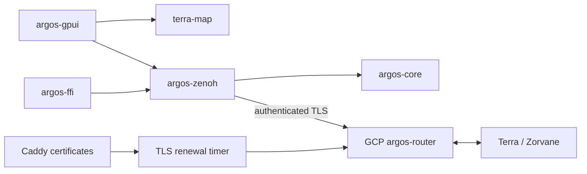

# ARGOS architecture and control boundary

ARGOS is a native fleet operator station. The GPUI dashboard uses `terra-map`
for rendering and `argos-zenoh` to connect directly to vehicles through Zenoh.
Terra owns sensing, onboard planning, command admission and motor watchdogs.

| Component | Responsibility |
| --- | --- |
| `crates/argos-gpui` | Desktop map, rover selection and operator controls |
| `crates/terra-map` | Google 3D Tiles, local model rendering and map interaction |
| `crates/argos-core` | Contracts, freshness, acknowledgements and operator state |
| `crates/argos-zenoh` | Fleet transport, telemetry validation, command publication, session logs and router binary |
| `crates/argos-ffi` | UniFFI facade retained for native consumers |
| `packaging/router` | Container build for the router |
| `packaging/gcp` | Router service, authentication, Caddy and TLS renewal |
| `tests/` | Rust unit/integration tests grouped by crate, plus deployment tests |
| `spikes/unity-dashboard` | Historical Unity prototype |

## Control and authentication

The desktop app publishes commands directly to Zenoh. Fleet username/password
credentials authenticate membership; they do not implement per-operator roles.
The desktop control claim is local state and does not fence other Zenoh clients.
Operators must coordinate use of a vehicle. The vehicle's runtime remains the
final authority for motion, hardware readiness, safety and stale commands.

The app distinguishes a sent request from an observed acknowledgement. Hardware
arming is explicit; selecting an autonomy level does not arm the vehicle.
Session logs in the transport are local records, not a centralized audit service.
The removed HTTP server's OAuth, CSRF, server-side claims and SQLite persistence
are no longer part of the architecture.

## GCP transport

Public clients use TLS on port 7448 and the `terra/phone` prefix. The internal TCP
listener stays bound to `127.0.0.1:7449`. Caddy retains ports 80/443 to obtain and
renew the hostname certificate; the timer copies renewed material into the router's
restricted TLS directory. The HTTPS status endpoint reports Caddy availability only.
