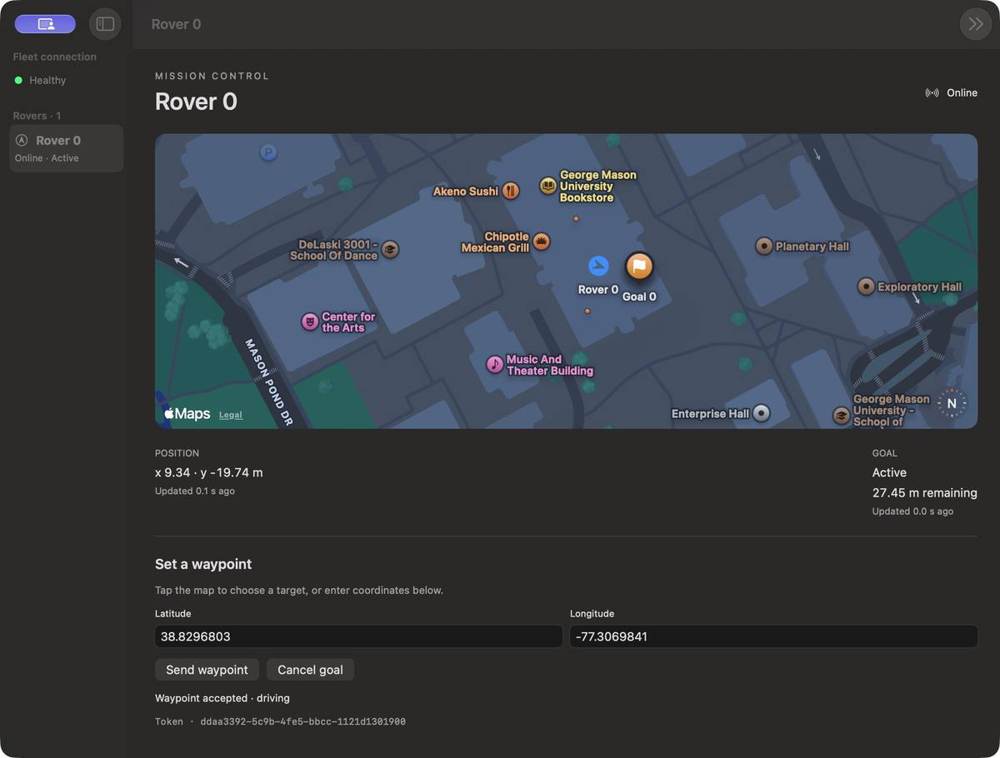
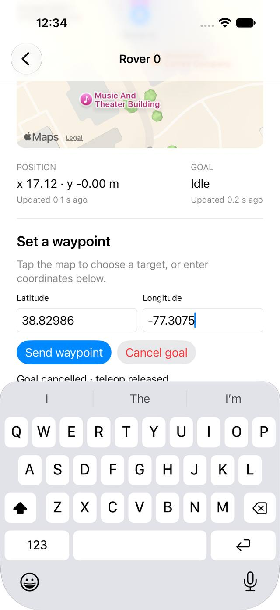

# Mission operator controls

> **Status — October 17, 2026:** This is a historical design, implementation record, or legacy workflow. The React dashboard and SwiftUI apps were removed on October 19, 2026. The operator surface is the GPUI app in `crates/argos-gpui`, which mounts the `terra-map` Map View. The HTTP service was removed on October 21, 2026; the desktop app uses Zenoh directly. Read the [removed browser dashboard](../browser-dashboard.md) for the retirement notice. Unity C3 proposals are superseded; recorded evidence remains specific to its original platform and date.

!!! tip "TL;DR"
    Four levels: Teleop, Assisted, Waypoint, Supervised.
    A proposal does not move the robot. Approve does.
    Stop latches. Reset is separate. The log can be exported.

*Requested level, the map, and the goal, on one screen.*

ARGOS keeps mission objectives, observed survivor reports, progress, and remaining budget visible while the operator changes authority. Terra owns all planning and final motor selection. The dashboard uses the shared Rust client through UniFFI on native macOS and iOS; no Python or Dioxus is introduced.

Select Teleop for precise manual movement, Assisted teleop for obstacle support, Waypoint for operator-directed transit, or Supervised for approving reachable search frontiers. A proposed goal alone never authorizes motion. Approval carries both the run identity and proposal ID; expiry, replacement, restart, and stale telemetry disable old decisions. Safety holds are displayed independently of requested and assigned levels.

Per-rover and fleet takeover clear held input before requesting Teleop. Emergency stop is latched at Terra; reset is separate. Fleet actions retain each target's acknowledgement independently; publication alone is not confirmation. W/S or arrows drive forward/reverse, A/D or arrows turn while the driving panel has keyboard focus. Touch pads use the same Rust input state. Leaving the view, losing focus, changing rover, or losing authority clears intent. Input ordering preserves independent releases and fences earlier presses after a clear.

For a fixed-level trial, pick a level under **Study condition · all rovers**. ARGOS sends `{"assigned_level": ...}` on each rover's `autonomy` topic and sends it again if a restarted rover does not report it. Terra rejects every other level with `level_not_assigned`, except L0 takeover (a fixed L4 also allows Search). If the rover's level is outside the condition, it drops to L0. ARGOS greys out the locked buttons. **Off** clears the condition. A window that has not picked a condition never sends one, so restarting ARGOS mid-trial leaves the rovers as they were.

Export session logs with **Export log** in the top bar. The JSONL manifest identifies the session; requests retain tokens, teleop packets retain session/sequence, and experiment snapshots identify rover runs and paired time samples. Goal/cancel actions and observed mission state are recorded. Recording failure is visible and leaves emergency controls available. Exporting an active session creates a flushed snapshot; it does not imply mission completion.

## Evidence

[Live control evidence](live-control-evidence.json) was collected against Terra's seeded disaster-search scenario with two rovers on a separate loopback port. Four changes were acknowledged in 0.11–0.54 seconds, waypoint arrival was reported, supervised approval was accepted, and both rovers acknowledged fleet takeover and stop. Rover logs contain assisted output and approved-frontier output. The exported operator session was correlated to rover receipts by token. These are local transport/runtime results, not native UI latency or physical robot measurements.

Rust core/FFI/loopback tests, macOS and iOS native unit tests, and Apple builds validate the adapters. Physical keyboard/touch focus behavior, complete operator study trials, and braking calibration require device/experiment evidence. The TerraPhone control endpoint is loopback-only because automatic approval review rejected a new unauthenticated LAN listener.

The Swift project and `scripts/build-apple.sh` were removed with `apps/apple` on October 19, 2026. This section records the build that existed then. The companion Terra guide is `Terra/docs/autonomy/README.md`; its protocol defines wire messages and mission detection rules. This branch builds on dashboard PR #5 and implements issue #4 with Terra #17.

The live smoke example can be repeated with `cargo run -p argos-zenoh --example mission_smoke -- tcp/127.0.0.1:7448`. Start the isolated Terra mission listener on that port first. The native UI test uses the same isolated port; it explicitly opens a window when macOS restores a windowless session.

*Same controls on the phone.*

## Occupancy grid and autonomy selector

The local map displays the selected rover's observed occupancy grid under the fleet's rover positions and waypoint goals. White indicates free cells (probability below 65), black occupied cells (65–100), and gray unknown cells (-1). The map uses world +X north and +Y west, equal metre scales on both screen axes, and the packet's world origin. Fit map frames the current grid; zoom changes the displayed extent. Stale grids fade and are labelled. Grids from a different run are hidden until matching telemetry arrives. The geographic view remains a separate coordinate view; choose the local map to see occupancy.

The Autonomy level menu sends a per-rover request for Teleop, Assisted Teleop, Waypoint, or Supervised according to Terra's advertised capabilities. Requested level, effective authority, safety reason, and request receipt are displayed separately. Requests are disabled while disconnected, stale, or awaiting acknowledgement. Takeover and stop remain separate operator actions.

### Manual verification

Testing is reserved for the operator at their request; the latest UI changes have not been verified by a completed native UI test.

1. Build the updated Terra simulator and start a mission using the command in Terra's autonomy guide.
2. The Apple project is no longer in the repository. This step applied to `apps/apple/ARGOS.xcodeproj` before that tree was deleted.
3. Connect to the simulator's endpoint (normally `tcp/127.0.0.1:7447`). Use the local map mode and select a rover.
4. Check the occupancy legend, rover position, map origin, and Fit map/zoom. Switch rovers to check their independent maps. Stop the simulator to check stale-map and disconnected states.
5. Choose each autonomy level and check the rover's acknowledgement and effective authority. A safety hold may prevent motion even when the requested level is accepted.
6. In Supervised, approve only a current proposal. Try per-rover takeover, emergency stop, and explicit reset. Use the waypoint fields to compare a clicked map target with exact world coordinates.

The development simulator for this change used isolated endpoint `tcp/127.0.0.1:7448`. No LAN listener was added.
