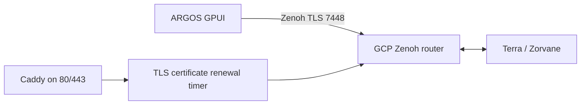

# Deployment

The active path is **ARGOS desktop app → authenticated Zenoh TLS router → Terra/Zorvane**.
The desktop app runs locally. GCP hosts the router and Caddy's certificate lifecycle.
There is no HTTP application server, browser dashboard, OAuth login or centralized
SQLite command audit service.

## Supported packaging

- [GCP router setup and migration](https://github.com/Super-Yojan/ARGOS/blob/main/packaging/gcp/README.md): authenticated router, service units, Caddy and certificate renewal.
- Root `compose.yaml`: unauthenticated development router exposed only on host loopback port 7448. Start with `docker compose up -d --build` and stop with `docker compose down`.
- [Legacy Mac-hosted router](deployment-router.md): historical LAN/Tailscale notes.

## Fleet connection

The desktop defaults to `tls/argos.34.135.204.210.sslip.io:7448`, prefix
`terra/phone`, user `terra`. Supply `ARGOS_ZENOH_PASSWORD` privately through
`.env` or the environment. Use the same endpoint and prefix on the vehicles.
A remote device cannot reach another machine through its own loopback address.

Public TLS uses the hostname certificate managed by Caddy. Keep ports 80/443
available for issuance and renewal, and port 7448 available for fleet clients.
Port 7449 remains bound to loopback on the GCP host. The renewal timer copies
certificates into `/var/lib/argos/tls` and restarts the router when they change.

## Operation and migration

The GCP installer stops/disables the retired HTTP service, preserves its stored
data for recovery, and preserves fleet credentials and custom router accounts.
It replaces the HTTP reverse proxy with a status page while retaining automatic
HTTPS. Follow the GCP guide for the deploy command and health checks.

`/healthz` now reports only Caddy availability. Confirm the router through systemd
and verify authenticated, fresh telemetry in the desktop app. There is no fleet
readiness HTTP endpoint. A successful build is not proof of a healthy live host.

Fleet authentication establishes membership, not individual operator permissions.
Desktop control claims do not fence other clients on the bus. Coordinate operators
and use the vehicle's observed authority, safety and hardware state. A waypoint
already accepted by a vehicle can outlive the desktop connection.
