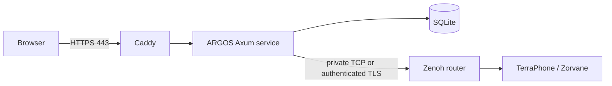

# Deployment

The primary deployment is **browser → HTTPS ARGOS service → Zenoh fleet router → Terra/Zorvane**. The Rust service serves the built web interface and API, authenticates invited GitHub accounts, and keeps command/audit state in SQLite.

## Supported packaging

- [Docker Compose hosting](browser-dashboard.md#public-hosting-for-one-team): Linux host, Caddy HTTPS, SQLite volume, and private fleet connectivity through Tailscale.
- [GCP system-service packaging](https://github.com/Super-Yojan/ARGOS/blob/main/packaging/gcp/README.md): installer, TLS router configuration, and service units. These are deployment instructions, not proof of a currently healthy hosted service.
- [Legacy Mac-hosted router](deployment-router.md): retained native fallback and LAN/Tailscale operation.

Do not enable demo development identity for a real fleet. Hosted configuration requires an HTTPS origin, GitHub OAuth credentials, and numeric viewer/operator account allowlists. Only operators can claim command control; mutations check origin and CSRF tokens.

## Fleet connection

Set `ARGOS_ZENOH_ENDPOINT` and `ARGOS_ZENOH_PREFIX` to the actual fleet/router. Defaults are `tcp/127.0.0.1:7448` and `terra/rover`. The Rust client supports `tcp/` and `tls/`; `ARGOS_ZENOH_USER` and `ARGOS_ZENOH_PASSWORD` supply paired bus credentials when configured. An unprotected TCP listener is not an authenticated deployment: keep it private. TLS certificate and router credential provisioning are described in the GCP packaging guide.

The browser never receives bus credentials. A remote phone uses a reachable router address, not the server's loopback address. Geographic projection requires valid frame/reference telemetry; a map tile configuration alone does not establish localization.

## Operation and recovery

Run one service instance. Browser control claims are in memory and are not a distributed lock. Native clients remain outside those claims, so coordinate operators across interfaces. Closing the browser does not cancel a waypoint already latched by Terra. Unpublished intent is discarded, and interrupted operations are not replayed after restart.

`/healthz` checks the HTTP process; `/readyz` checks fleet-link health. Neither certifies armed hardware or safe motion. Follow the [browser guide](browser-dashboard.md) for audit history, SQLite backup/restore, and rollback. Hardware/runtime validation remains a separate step from a successful service build.

An AWS tunnel was an earlier proposal, not the current deployment requirement. The browser architecture does not require a particular cloud provider.
