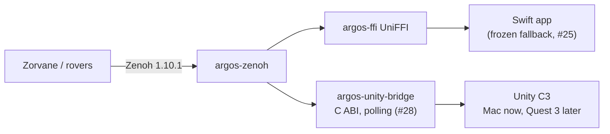

# Decision record: 3D dashboard framework (Unity C3)

> **Summary.** Build the next operator station ("C3") in **Unity 6 + a Rust
> C-ABI bridge over `argos-zenoh`**; keep the Swift app frozen as the fallback
> (#25). Evidence: spike PR #24. **Status: Proposed — awaiting Yojan's
> confirmation** (two criteria were not measured; see below). Accepting this
> unblocks #28. Closes the record part of #15.

## Context

The dashboard must show a 20-rover fleet on Zorvane terrain, desktop first and
Quest 3 later (`3d-dashboard.md` §8). Today's app is Swift + SceneKit fed by
Rust through UniFFI; it cannot run on Quest. There is no official Zenoh C#
binding.

## Options

| Criterion (#15) | A. Swift / RealityKit | B. Unity + OpenXR (spike #24) |
| --- | --- | --- |
| 1. Zenoh client | ✅ shipping (UniFFI, Zenoh 1.10.1) | ✅ `argos-unity-bridge` cdylib on `argos-zenoh` 1.10.1; **8 live rovers + 8 occupancy grids on the Mac** |
| 2. Terrain (GMU patch) | ⚪ not run (SceneKit scene, no tiles) | ✅ USGS 3DEP Terrarium patch + NAIP imagery + OSM buildings, same anchor maths as `argos_core::Anchor` |
| 3. 20 vehicles frame time | ⚪ not measured | 🟡 20 mock rovers rendered and framed; **frame time not measured** |
| 4. Mac + Quest reach | ❌ Apple only | 🟡 Mac player ✅ (67 MB, Mono); Quest/OpenXR **not run** |
| 5. Reuse Rust crates | ✅ via UniFFI | ✅ via C ABI; `argos-core/zenoh/ffi` unchanged |

## Decision (proposed)

**Option B — Unity C3**, desktop Mac first. Swift stays frozen for Oct 24/31.

- [ ] **Yojan to confirm** (or reject) — spike is conclusive on Zenoh, maps and
  Mac build, **not** on 20-rover frame time or Quest.

## Consequences

- **Unblocks #28**: promote `argos-unity-bridge` from `spikes/` to `crates/` with CI.
- Rust stays the single Zenoh/contract layer; Swift and Unity both consume it.
- New costs: Unity license per machine (cloud VM cannot run Unity — exit 198), a
  C# side to test, a Mac-only verification loop (`run-*-mac.sh`).
- Swift app retires after the Unity C3 runs the November outdoor tests.

## Still unknown (record before closing #15)

1. 20-rover frame time + hardware on the Mac (Unity; Swift for comparison).
2. Quest 3 / OpenXR build — deferred to #22.
3. `ZenohSnapshotTests` / `MapTests` EditMode runs on the Mac.
