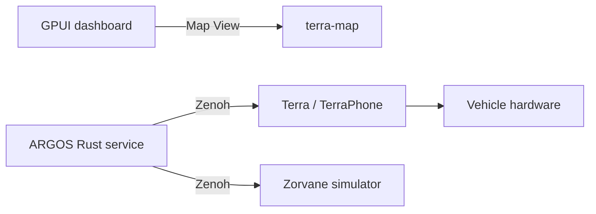

# ARGOS

ARGOS is the operator station for Terra vehicles and the Zorvane simulator. **New dashboard development targets the GPUI app** in `crates/argos-gpui`, which mounts the Map View from `crates/terra-map`. The Rust service still owns sessions and Zenoh. The React and SwiftUI dashboards have been removed. Unity is a historical experiment.

Terra owns sensing, onboard planning, motor output, and watchdogs. The service displays observed state and submits operator intent once a client calls it. The GPUI window currently shows the map only; it does not yet subscribe to the fleet bus. The service never gives the map a vehicle command by itself.

## Run and operate

Start with [getting started](getting-started.md). The [removed browser dashboard](browser-dashboard.md) records the React interface and the service behavior that is still in `argos-server`. Use the simulator before hardware validation.

| Guide | Purpose |
| --- | --- |
| [Current status](roadmap.md) | Implemented behavior and what the GPUI window does not do yet |
| [Architecture](DESIGN.md) | Crates, service, and vehicle responsibility |
| [Command model](vision.md) | Waypoints, manual authority, future intent planning |
| [Deployment](deployment.md) | HTTPS hosting and private fleet connectivity for the service |
| [Zenoh interfaces](zenoh.md) | Fleet wire contract and observation semantics |
| `crates/terra-map/src/MAPS.md` | Google tiles, models, and the dashboard binary |
| [Legacy mission controls](autonomy/README.md) | Historical native capabilities and evidence |
| [Two-stage VLA](vla.md) | Research direction; not a deployed operator planner |

Earlier Apple screenshots, the React dashboard, and Unity/3D design documents are historical evidence, not the current window.

Source repositories: [ARGOS](https://github.com/Super-Yojan/ARGOS), [Terra](https://github.com/Super-Yojan/Terra), [Zorvane](https://github.com/Super-Yojan/Zorvane), and [Masters-Thesis](https://github.com/Super-Yojan/Masters-Thesis).
