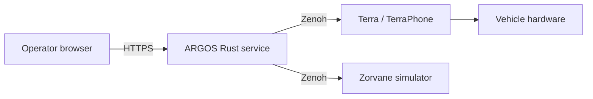

# ARGOS

ARGOS is the web operator station for Terra vehicles and the Zorvane simulator. **New dashboard development targets the browser**, with a React interface and Rust service. The Apple dashboard is a legacy fallback; Unity is retained as a historical experiment.

Terra owns sensing, onboard planning, motor output, and watchdogs. ARGOS displays observed state and submits operator intent. The browser never connects directly to the vehicle bus.

## Run and operate

Start with the [local browser demo](getting-started.md), then follow the [browser dashboard guide](browser-dashboard.md) for vehicle controls, deployment, authentication, and command semantics. Use the demo and simulator before hardware validation.

| Guide | Purpose |
| --- | --- |
| [Current status](roadmap.md) | Implemented behavior, migration gaps, historical work |
| [Architecture](DESIGN.md) | Browser, service, Rust client, vehicle responsibility |
| [Command model](vision.md) | Waypoints, manual authority, future intent planning |
| [Deployment](deployment.md) | HTTPS hosting and private/authenticated fleet connectivity |
| [Zenoh interfaces](zenoh.md) | Fleet wire contract and observation semantics |
| [Legacy mission controls](autonomy/README.md) | Native fallback capabilities and historical evidence |
| [Two-stage VLA](vla.md) | Research direction; not a deployed operator planner |

The earlier Apple screenshots and Unity/3D design documents are historical evidence, not screenshots or specifications of the current browser interface.

Source repositories: [ARGOS](https://github.com/Super-Yojan/ARGOS), [Terra](https://github.com/Super-Yojan/Terra), [Zorvane](https://github.com/Super-Yojan/Zorvane), and [Masters-Thesis](https://github.com/Super-Yojan/Masters-Thesis).
