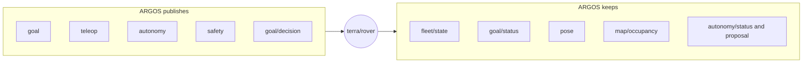
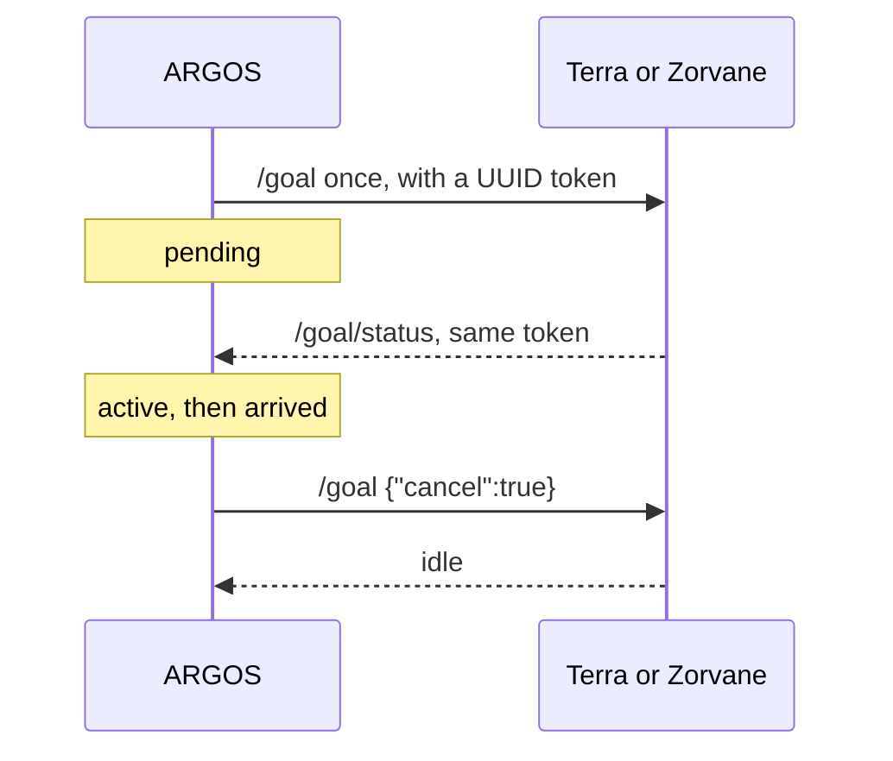

# Zenoh interfaces

!!! tip "TL;DR"
    The ARGOS service is a Zenoh TCP/TLS client. Multicast is off.
    Default prefix: `terra/rover`. The web service defaults to `tcp/127.0.0.1:7448`; legacy clients and standalone simulators may use 7447.
    Goals go out once. Status with the same token means accepted.
    Teleop is `<id>/teleop`. ARGOS does not publish `cmd_vel`.

*One session. Mode `client`. Connect timeout 3 seconds. Endpoints support `tcp/…` and `tls/…`; paired credentials are supported.*

## Round trip for a waypoint

*After 150 seconds with no matching token: unconfirmed. ARGOS does not retry. Disconnect does not cancel.*

## Subscriptions

| Key | What ARGOS keeps |
| --- | --- |
| `<prefix>/fleet/state` | `count`, `max_count`, `ids` |
| `<prefix>/*/goal/status` | `idle` / `active` / `arrived`, distance, target `x`/`y`, token |
| `<prefix>/*/pose` | JSON pose when the phone runtime publishes it |
| `<prefix>/*/localization` | Frame and placement report |
| `<prefix>/*/{autonomy/status,goal/proposal,mission/status,experiment/status}` | Authority, proposals, mission/experiment |
| `<prefix>/*/{hardware/status,pose/quality,navigation/outdoor,search/report,search/status}` | Hardware, pose quality, outdoor navigation, search |
| `<prefix>/*/objects` | Found buckets and balls, schema 1: local `x`/`y`, and `latitude`/`longitude` when the rover had a good GPS fix. Confirmed ones are drawn on the map |
| `<prefix>/<selected>/map/occupancy` | Grid, schema 1, cells −1…100. Selected rover only |
| `<prefix>/<selected>/{map/occupancy/heartbeat,pointcloud,pointcloud/heartbeat}` | Point cloud and content heartbeats. Selected rover only |
| `<prefix>/<selected>/camera/depth` | `body` pose from the header. Pixels are dropped. Selected rover only |

Each key is declared on its own, with no `<prefix>/*/**` wildcard, so the router forwards only what ARGOS reads. `Client::focus` moves the selected-rover subscriptions; the dashboard calls it from the selection.

Fleet supervision and waypoint submission use a 90-second receipt-age horizon. Manual and hardware controls use stricter limits (0.5 seconds); occupancy display fades after 2.5 seconds. A content heartbeat refreshes only its matching cached visualization and never renews control authority.

`goal/status` `x` and `y` are the target. Position comes from pose.

## Publications

| Key | Body |
| --- | --- |
| `<prefix>/<id>/goal` | One local or WGS84 goal, plus `token`. Or `{"cancel":true}` |
| `<prefix>/<id>/autonomy` | `level` + `token`; supported levels are advertised by the vehicle |
| `<prefix>/<id>/hardware` | Explicit arm/disarm, token, run and authority revision |
| `<prefix>/<id>/navigation/settings` | Validated geometry/planner parameters and revisions |
| `<prefix>/<id>/safety` | `stop` or `reset`, plus `token` |
| `<prefix>/<id>/goal/decision` | `approve`, `reject`, or `resume` |
| `<prefix>/<id>/mission/report` | `survivor_id` + `token` |
| `<prefix>/<id>/teleop` | Bounded `linear`/`angular` intent with session/sequence fencing; cadence and limits depend on the client |

Fleet stop and fleet takeover send one message per rover. Each rover keeps its own token.

## Other keys on the same bus

Zorvane still has these. This client leaves them alone.

| Key | Who uses it |
| --- | --- |
| `<prefix>/<id>/cmd_vel` | Zorvane’s Python client, and TerraPhone’s direct drive |
| `<prefix>/<id>/camera/rgb` | Frame viewers. ARGOS never decodes RGB |
| `<prefix>/fleet/size` | Live resize. ARGOS only reads `fleet/state` |

Depth frames for the selected rover still arrive whole, so that bandwidth is on the link. Point-cloud telemetry is a separate topic; depth pixels are discarded by this client. Native/Unity visualizations and the browser occupancy overlay are distinct consumers.

## Session log

On connect, the desktop app writes `argos-session-<uuid>.jsonl` in `Documents/ARGOS Sessions` (or `ARGOS_SESSION_DIR`). `Client::connect` without a folder still uses `ARGOS_SESSION_DIR` or the temp directory.

Goals, cancels, actions, teleop packets, and observed state each get a line.

**Export log** in the top bar writes a flushed copy next to it, named with the study condition. A failed recorder stays visible. Stop still works.
