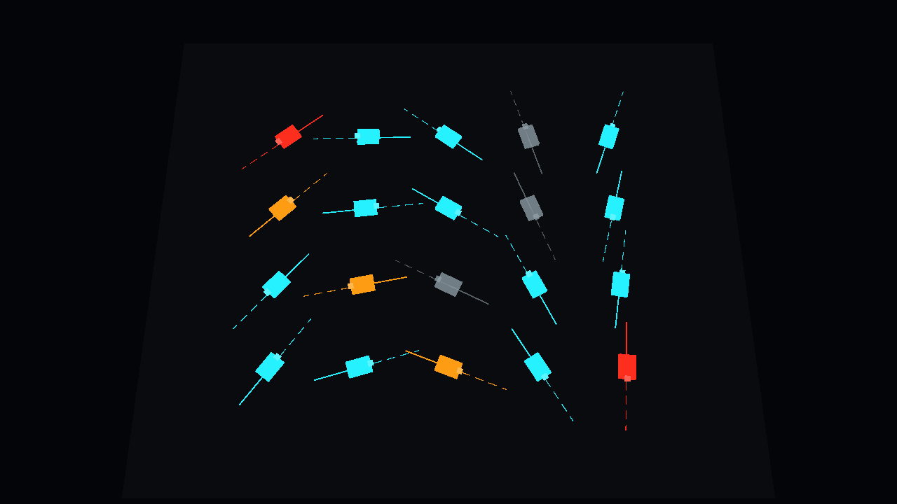
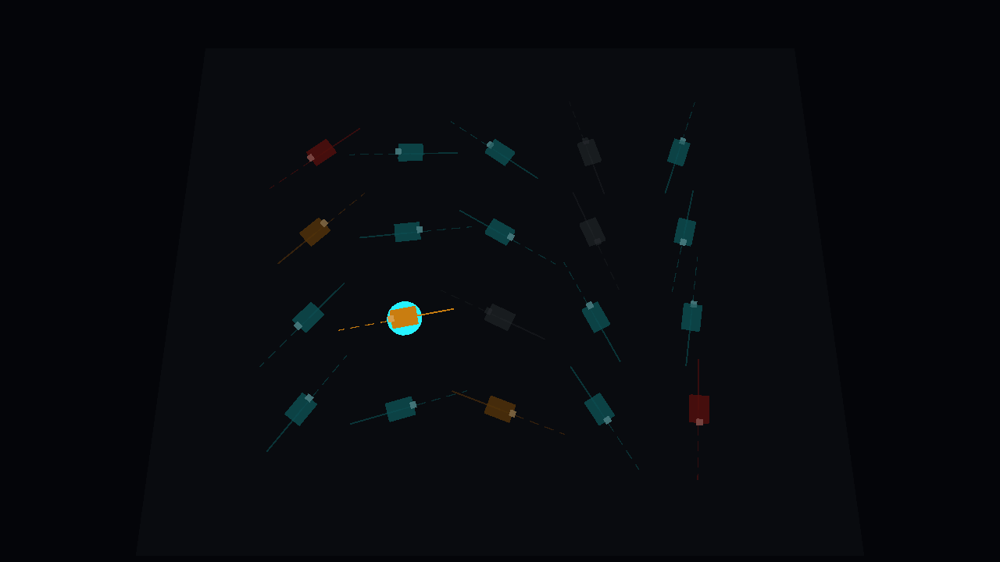

# Unity dashboard spike report

Feasibility only. A cloud agent tried to build a rough ARGOS 3D fleet view in Unity 6 LTS and run the headless loop on this VM. The first pass used mock telemetry. A later section records the Zenoh native-plugin follow-up. No edits to existing ARGOS Rust or Swift behavior. The new crate only consumes `argos-zenoh` and `argos-core`.

The design source is `docs/design/3d-dashboard.md` on `main` (merged from PR #23). The prototype is `spikes/unity-dashboard/`: Unity `6000.3.26f1` (`de8167e7440c`), 20 placeholder rovers from `Assets/StreamingAssets/fleet-telemetry.json`, cyan / amber / red status color, solid completed paths, dashed planned paths, ghosted when the pose is older than 2.5 s, and a selection that dims the rest. EditMode tests for that stale rule live in `Assets/Tests/EditMode/TelemetryParserTests.cs`. `run-spike.sh` is the local a–e loop. `.github/workflows/unity-dashboard-spike.yml` is the optional GameCI loop (`workflow_dispatch` only).

## Pass / fail

| Step | Result | Evidence |
| --- | --- | --- |
| a. Install the Unity editor | **PASS** | Host binary `/opt/unity/6000.3.26f1/Editor/Unity -version` prints `6000.3.26f1`. GameCI image `unityci/editor:ubuntu-6000.3.26f1-linux-il2cpp-3.2.2` also runs that binary and prints `6000.3.26f1`. |
| b. License activation | **FAIL** | No license secret, `.ulf`, or serial in the environment. Editor exits **198**. |
| c. EditMode tests, NUnit XML | **FAIL** | Same exit 198. The test runner never started. `artifacts/editmode-results.xml` was not written. |
| d. Linux player | **FAIL** | `-buildLinux64Player` exits 198 before any compile or IL2CPP link. No player binary. |
| e. Xvfb screenshots and ~10 s video | **FAIL** | Not run. There was no player to launch. No screenshot and no video. |

`b` is the blocker for `c`–`e` on this VM. The commands for `c` and `d` were still invoked. They die in the license client, before script compilation.

## Mac (owner machine)

The owner ran the same project on an Apple Silicon Mac with Unity `6000.6.5f1` and a valid Personal license. The project file still pins `6000.3.26f1`; the newer editor opened it.

| Step | Result |
| --- | --- |
| License | **PASS** — Personal license accepted in `-batchmode` |
| EditMode tests | **PASS** — 9/9 |
| Mac player | **PASS** — `-buildOSXUniversalPlayer`, 67 MB, Mono |
| Capture | **PASS** — `-argosCaptureDir` and `-argosQuit` wrote `overview.png` and `selected.png` |

Two compile/build fixes were required before that run, and they are in this branch now:

1. `Assets/Editor/FleetSceneSetup.cs` needs `using UnityEditor.Build;`. Without it, `NamedBuildTarget` is unresolved (`CS0103` at the `SetScriptingBackend` call).
2. `ProjectSettings/ProjectSettings.asset` had `scriptingBackend` Standalone set to `1` (IL2CPP). The Mac has no IL2CPP module, so the player build failed with `Currently selected scripting backend (IL2CPP) is not installed`. The committed default is Mono (`0`). `PrepareLinuxPlayer` still sets IL2CPP immediately before the Linux player build.

The first Mac capture showed about 10 of the 20 rovers, crowded into the lower half of the 1280×720 frame. The scene camera is now at `(0, 36, -12)`, pitched 72°, field of view 40, and the ground uses an opaque unlit shader so it draws before the rovers. The owner rebuilt the scene and the Mac player from commit `76785ab` on Unity `6000.6.5f1`. That framing fix is verified: the new overview and selection captures show all 20 rovers in frame.





## Zenoh bridge

Unity has no usable current C# Zenoh binding. This follow-up adds `spikes/unity-dashboard/native/argos-unity-bridge`, a cdylib Unity polls from the main thread. It calls `argos_zenoh::Client::connect` and `Client::snapshot`, so the session mode, connect timeout, multicast-off setting, and topic set stay the ones ARGOS already uses. `argos-core`, `argos-zenoh`, and `argos-ffi` are unchanged.

Zenoh version: **1.10.1**, the workspace pin `zenoh = { version = "=1.10.1", default-features = false, features = ["transport_tcp"] }`. One Zenoh crate, shared with `argos-zenoh`. The VM proof used rustc 1.99.0. The image default, 1.83.0, cannot parse edition 2024; this repo already requires Rust 1.85 or newer.

Default endpoint `tcp/127.0.0.1:7447`, prefix `terra/rover`. The client subscribes to `fleet/state`, `*/pose`, `*/camera/depth`, and the operator topics `Client` already keeps (`autonomy/status` among them).

The C API is polling only. There is no native-to-managed callback, so the same entry points stay valid under Mono and IL2CPP.

| Entry | Role |
| --- | --- |
| `argos_bridge_open(endpoint, prefix)` | Connect. `0` on success, negative on failure. |
| `argos_bridge_close` | Drop the session. |
| `argos_bridge_connected` | `1` while a session is open. |
| `argos_bridge_link` | `connecting`, `healthy`, `stale`, or `disconnected`. |
| `argos_bridge_poll` | Copy a JSON fleet snapshot into a caller buffer. |
| `argos_bridge_last_error` | Text for the last open failure. |

The JSON matches the mock file `TelemetryParser` already reads: `snapshotUnixSeconds`, `rovers[].id`, `position` `{x,y,z}`, `headingDegrees`, `status`, `lastUpdateUnixSeconds`. Pose `x` stays Unity `x`. Pose `y` becomes Unity `z`. Unity `y` is `0`. Yaw radians become degrees. Ids are `terra-01` for rover `1`. `lastUpdateUnixSeconds` is wall-clock now minus pose age, so a pose older than 2.5 s takes the existing ghost path. Status strings:

| JSON `status` | When |
| --- | --- |
| `critical` | `safety` is `emergency_stop`, `reason` is `map_stale` / `sensor_unhealthy` / `invalid_time`, pose age is over 2.5 s, or membership is not `online` |
| `attention` | `safety` is `hold`, a `goal/proposal` is waiting, or autonomy `result` is `rejected` with `request_reason` `authority_required` |
| `normal` | a fresh pose with none of the above |

`-argosSource zenoh -argosEndpoint tcp/127.0.0.1:7447` selects the live source. `-argosPrefix` overrides the prefix (default `terra/rover`). Any other value, including omitting the flag, keeps the mock JSON file. `FleetDashboard` still evaluates rovers with `TelemetryParser` and colors them with `StatusLanguage`.

Fake fleet, no Zorvane (this process listens):

```sh
cargo run -p argos-unity-bridge --bin argos-fleet-publisher -- --count 8 --listen
```

It publishes `terra/rover/fleet/state`, `terra/rover/<id>/pose`, and `terra/rover/<id>/camera/depth`. `terra-02` sends `autonomy/status` with `safety=hold` (attention). `terra-03` sends `safety=emergency_stop` (critical). `--count` is 1..=32. `--endpoint` and `--prefix` override the defaults.

Zorvane already owns `fleet/state`. Do not point the fake publisher at a running Zorvane. From a Zorvane checkout, raise the rover count and point the player at the simulator:

```sh
TERRA_ROVER_COUNT=8 TERRA_TILES=1 TERRA_TILES_FETCH=0 cargo run -p zorvane
```

```sh
ArgosFleetDashboard.app/Contents/MacOS/ArgosFleetDashboard \
  -argosSource zenoh \
  -argosEndpoint tcp/127.0.0.1:7447 \
  -argosCaptureDir /tmp/argos-zenoh \
  -argosQuit
```

`TERRA_ROVER_COUNT` can be 15 to 20. The maximum ARGOS keeps in one fleet message is 32.

### Passed on this VM

| Check | Result |
| --- | --- |
| `cargo build -p argos-unity-bridge` | **PASS**. `target/debug/libargos_unity_bridge.so` exports `argos_bridge_open`, `argos_bridge_close`, `argos_bridge_connected`, `argos_bridge_link`, `argos_bridge_poll`, and `argos_bridge_last_error`. `argos-fleet-publisher` builds in the same crate. |
| `cargo test -p argos-unity-bridge` | **PASS**, 3 tests, rustc 1.99.0. `publisher_fleet_arrives_through_the_c_api` listens with the publisher and reads the fleet back through the C API: 4 rovers, link `healthy`, `terra-01` at the grid pose with heading 90°, `terra-02` attention, `terra-03` critical, `terra-04` normal, each sample younger than 2.5 s. `rejected_endpoint_is_reported_without_opening` returns `-3` for a non-tcp endpoint and stays disconnected. The JSON unit test checks the 2.5 s timestamp boundary. |
| Unity player, EditMode, screenshots | **Not run**. This VM still has no Unity license. The editor was not started. |

### Pending on the Mac

The owner runs:

```sh
./spikes/unity-dashboard/run-zenoh-mac.sh
```

`UNITY_EDITOR` overrides the editor. The default is `/Applications/Unity/Hub/Editor/6000.6.5f1/Unity.app` (the script also accepts `Contents/MacOS/Unity`). The script builds the dylib for `aarch64-apple-darwin`, copies it to `Assets/Plugins/macOS` with ARM64 import settings, builds a Mono Mac player, starts the fake publisher on `tcp/127.0.0.1:7447`, and runs the player with `-argosSource zenoh -argosCaptureDir -argosQuit`. It exits nonzero unless the player log contains `ARGOS live rovers: N` for N at least 1 and `presentation.txt` lists a `terra-` rover. Stop Zorvane first if port 7447 is taken. `ARGOS_ROVER_COUNT` (default 8), `ARGOS_ENDPOINT`, and `ARGOS_PREFIX` are optional.

`Assets/Tests/EditMode/ZenohSnapshotTests.cs` parses a bridge-shaped snapshot through `TelemetryParser` and checks attention, critical, and the ghost after 2.5 s. It does not load the native plugin. It has not been executed on this VM. The Mac script does not run EditMode; the previous `-runTests` invocation will pick the new test up.

## Maps

Two layers. The owner’s Zenoh player run had already passed (8 live rovers, status colors correct) before this section.

### Terrain

The ground is an offline patch centered on the ARGOS / Zorvane anchor, George Mason University Fairfax, `38.8297, -77.3075`. Local metres match `argos_core::Anchor` and Swift `MapProjection`: `+x` north, `+y` west, scale `40075016.686 / 360`. Unity stores north in `x` and west in `z`. Rover roots sample the mesh so they sit on the surface.

Elevation is Terrarium tile `15/9347/12543` from the AWS Open Data bucket `elevation-tiles-prod` (Mapzen / Tilezen packaging), file `Assets/StreamingAssets/terrain/gmu-fairfax-terrarium.png`. Height is `(R * 256 + G + B / 256) - 32768`. The anchor pixel is subtracted so the campus origin is `y = 0`. Fairfax is USGS 3DEP, which The National Map places in the public domain; USGS asks for credit. The bundle says: `United States 3DEP terrain data courtesy of the U.S. Geological Survey.` Zoom 16 is not in that bucket for this tile, so the patch is the zoom-15 tile (about 4 m per pixel).

Imagery is a 512×512 USGS NAIP export of the same bounds, `gmu-fairfax-naip.png`. NAIP is a U.S. Government work, public domain. The material desaturates and darkens it so cyan, amber, and red stay readable. Attribution is in `Assets/StreamingAssets/terrain/SOURCE.md`.

### Occupancy

Per-rover grids, not a merged fleet map. Terra #36 (shared fleet map, and the Zorvane work in Zorvane #5) is still a gap. The key that exists is `<prefix>/<id>/map/occupancy`, schema 1: `width`, `height`, `resolution`, `origin_x`, `origin_y`, row-major cells `-1…100`. `Client::occupancy_snapshot` already keeps the latest grid per fleet member.

The C API stays polling-only:

| Entry | Role |
| --- | --- |
| `argos_bridge_poll_map_index` | One JSON object per rover: id, sequence, run id, age, origin, size. No cells. |
| `argos_bridge_poll_map(rover_id)` | That rover’s cells. `-4` if it has no grid. |

Unity uploads a texture only when `sequence` or `runId` changes. A grid older than 0.5 s is dropped, matching `OccupancyFrame.usable` in the Swift app. The quad is translucent gray in world metres (`+x` columns, `+y` rows). Unknown cells are clear. Selection dims the other grids. The fake publisher sends a 16×16 grid at 0.5 m, centered on each rover, with an occupied block just north of it.

Zorvane, without the fake publisher:

```sh
TERRA_ROVER_COUNT=8 TERRA_TILES=1 TERRA_TILES_FETCH=0 cargo run -p zorvane
```

`TERRA_ROVER_COUNT` can be 15 to 20. Do not also run `argos-fleet-publisher` against that port; both write `fleet/state`.

### Passed on this VM

| Check | Result |
| --- | --- |
| `cargo test -p argos-unity-bridge` | **PASS**, 5 tests, Zenoh **1.10.1**. `publisher_fleet_arrives_through_the_c_api` now also reads four occupancy grids through `argos_bridge_poll_map`. Rover 1’s grid is 16×16, resolution 0.5 m, origin centered on its pose, age under 0.5 s, border cell `-1`, occupied cell `90`. `map_index_omits_cells_and_the_grid_poll_keeps_them` checks the version index has no cell payload. `gmu_anchor_round_trips_through_argos_core` checks `Anchor` at `38.8297, -77.3075` for local `(12, 4)`. |
| `cargo build -p argos-unity-bridge` | **PASS**. The dylib exports `argos_bridge_poll_map` and `argos_bridge_poll_map_index`. |
| Unity player and the new EditMode tests | **Not run**. No license on this VM. `MapTests` covers the projection, Terrarium decode, the manifest anchor, cell placement, and the 0.5 s freshness window. |

### Pending on the Mac

```sh
./spikes/unity-dashboard/run-maps-mac.sh
```

That is `run-zenoh-mac.sh` with the maps check turned on. Default Unity is `/Applications/Unity/Hub/Editor/6000.6.5f1/Unity.app` (`UNITY_EDITOR` overrides it). The script exits nonzero unless the player logs `ARGOS occupancy grids: N` for N at least 1 and both `overview.png` and `selected.png` are written. Stop anything already listening on `tcp/127.0.0.1:7447`.

## Exact errors

Host editor (`spikes/unity-dashboard/artifacts/editmode.log`), and the same text from the GameCI `unity-editor -quit` entrypoint:

```
[Licensing::Module] Error: Access token is unavailable; failed to update
[Licensing::Client] Error: Code 404 while processing request (status: Found 0 entitlement groups and 0 free entitlements matching requested entitlement ids)
[Licensing::Module] Error: 'com.unity.editor.headless' was not found.
No valid Unity Editor license found. Please activate your license.
```

Process exit code: **198**. `xvfb-run` itself only logged harmless `xkbcomp` keysym warnings.

Checked env names, all unset: `UNITY_LICENSE`, `UNITY_LICENSE_FILE`, `UNITY_EMAIL`, `UNITY_PASSWORD`, `UNITY_SERIAL`, `UNITY_LICENSING_SERVER`. `gh secret list` on this repo returned HTTP 403, so GitHub secret names could not be listed from this run. Nothing in the process environment supplied a license. No Unity account was created and no one else's credentials were used.

## VM facts

| Fact | Value |
| --- | --- |
| OS | Ubuntu 24.04.4 LTS, kernel `6.12.94+`, x86_64 KVM guest |
| CPU | 4 vCPU, Intel Xeon (family 6 model 207) |
| RAM | 15 GiB, no swap. About 4.8 GiB available when the editor started. The license abort happened before a heavy import, so IL2CPP memory use was not measured. |
| Disk | 254 GiB volume. After the editor install, about 20 GiB used and 234 GiB free. |
| GPU | No `nvidia-smi`. `lspci` is not installed. `/dev/dri` is absent. No hardware GL device. |
| Display tools | `xvfb-run` and `ffmpeg` are installed. They were not asked to capture a window. |
| Init | PID 1 is `tini`, not systemd. `invoke-rc.d` refused to start `docker.service` (`policy-rc.d` denied, no sysv script). |
| Editor install | Official tarball `Unity-6000.3.26f1.tar.xz` (4,540,380,840 bytes) plus `LinuxEditorTargetInstaller/UnitySetup-Linux-IL2CPP-Support-for-Editor-6000.3.26f1.tar.xz` (59,392,156 bytes). The old `TargetSupportInstaller/` URL for that module returns 404. Installed under `/opt/unity/6000.3.26f1` (about 8.4 GiB). `ldd` on `Editor/Unity` reported no missing libraries after the apt packages in `run-spike.sh`'s notes (GTK, NSS, Mesa, clang 18, lld). |
| Linux player module | The IL2CPP support archive contains both IL2CPP and Mono player variations. The committed Standalone scripting backend is Mono (`0`), after the Mac build fix. `PrepareLinuxPlayer` still switches that build to IL2CPP. The Linux player build never got that far on this VM. |
| Docker | Not installed at boot. `sudo apt-get install -y docker.io` installed Docker 29.1.3. Manual `sudo dockerd --iptables=false --storage-driver=vfs` reaches `sudo docker info` (cgroup v2, vfs). The first `run-spike.sh` probe recorded "failed to become ready" because it called `docker info` without sudo; the socket is root-owned. That probe is fixed to use sudo. |
| GameCI image | `docker pull unityci/editor:ubuntu-6000.3.26f1-linux-il2cpp-3.2.2` succeeded. `docker images` reported the image at 10.4 GiB. vfs storage grew `/var/lib/docker` to about 194 GiB while unpacking it (disk 85% full, 40 GiB free). The image was deleted after the version and license checks. Disk returned to about 20 GiB used. Do not leave this image on the vfs driver. |

## What the owner must provide

A Personal license cannot be activated headlessly on this VM. Unity's licensing client has no account token, so the headless entitlement `com.unity.editor.headless` is missing. Activation has to happen once in Unity Hub, on a machine the owner controls (the Mac is the natural place). This spike did not verify that a `.ulf` created on macOS is accepted here. GameCI documents that file as portable across OS and editor version. If Unity rejects it as machine-bound, the working alternative is a paid serial or a floating license server.

### Personal (free)

1. Install Unity Hub and sign in with the Unity account that should own CI.
2. Unity Hub → Preferences → Licenses → Add → **Get a free personal license**. Hub can show a license before it writes the file. Use Add so the `.ulf` is created.
3. Copy that file. GameCI's paths:
   - macOS: `/Library/Application Support/Unity/Unity_lic.ulf` (also check `~/Library/Application Support/Unity/Unity_lic.ulf`)
   - Linux: `~/.local/share/unity3d/Unity/Unity_lic.ulf`
   - Windows: `C:\ProgramData\Unity\Unity_lic.ulf`
4. GitHub → this repo → Settings → Secrets and variables → Actions. Create:
   - `UNITY_LICENSE` — the `.ulf` XML pasted as-is, not base64
   - `UNITY_EMAIL` — the Unity account email
   - `UNITY_PASSWORD` — the Unity account password

Leave `UNITY_SERIAL` unset for a Personal license. GameCI says not to mix the Personal file with a Professional serial.

Local rerun on a machine that already has the editor:

```bash
UNITY_LICENSE_FILE=/path/to/Unity_lic.ulf ./spikes/unity-dashboard/run-spike.sh
```

`UNITY_LICENSE` may be either a path to the `.ulf` or the raw XML. The script writes a temp file and passes `-manualLicenseFile`. It does not print the file.

### Professional serial

Subscribe, copy the serial (`XX-XXXX-XXXX-XXXX-XXXX-XXXX`), and set:

- `UNITY_SERIAL`
- `UNITY_EMAIL`
- `UNITY_PASSWORD`

Do not also set `UNITY_LICENSE`. The script and the workflow pass the serial through to the editor as `-serial` / `-username` / `-password` (the workflow via the GameCI actions' own env handling).

### Floating license server

Point GameCI at the server with the action input `unityLicensingServer`. The local script reads `UNITY_LICENSING_SERVER` only to record whether it is set; it does not yet pass it through. A server URL was not available here.

## How CI consumes it

`.github/workflows/unity-dashboard-spike.yml` is `workflow_dispatch` only, so it does not fail every pull request while the secrets are absent. After the secrets exist, run it by hand. It uses:

- `game-ci/unity-test-runner@v4` — EditMode, project `spikes/unity-dashboard`, Unity `6000.3.26f1`, NUnit results uploaded as `editmode-results`
- `game-ci/unity-builder@v4` — `targetPlatform: StandaloneLinux64` (the `ubuntu-6000.3.26f1-linux-il2cpp-3.2.2` image)
- a follow-up step that launches the player with `-force-glcore` under Xvfb and records about 12 seconds with `ffmpeg`

Both jobs pass `UNITY_LICENSE`, `UNITY_EMAIL`, `UNITY_PASSWORD`, and `UNITY_SERIAL` from Actions secrets. GameCI writes the `.ulf` and adds `-manualLicenseFile` for the Personal path. Those actions return the license after the step when the activation method needs it.

GitHub-hosted `ubuntu-24.04` runners have the same shape of problem this VM has for step e: no GPU. `-force-glcore` plus Mesa llvmpipe is the attempt, and it was not reached here, so that capture step is still unproven.

## Recommendation

Do the Unity dashboard work on the owner's Mac. That machine already proved the loop: a Personal license, 9/9 EditMode tests, a 67 MB Mono player, and the two captures. This VM can install Unity 6.3 LTS, and the GameCI editor image runs here, but it cannot compile, test, build, or screenshot the project until a license file exists. After that file is a secret, EditMode tests are a reasonable cloud/CI job. The 3D loop is a poor fit for this VM even then: there is no GPU, llvmpipe was never exercised, RAM is 15 GiB with no swap, and the GameCI image on Docker's vfs driver occupied about 194 GiB for a 10.4 GiB image. Scene iteration, frame timing at 20 rovers, and the look of the status language belong on the Mac, where Unity Hub, a GPU, and the rest of ARGOS already are.
